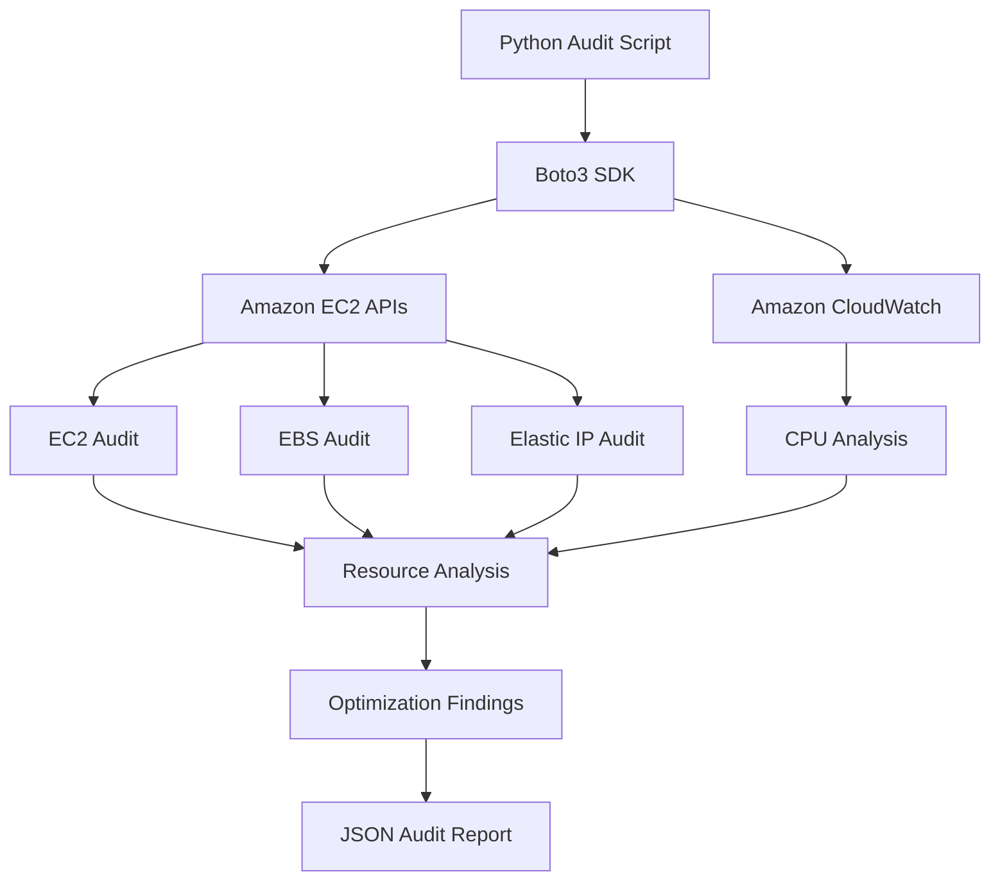

# AWS Cost Optimization & Resource Audit Tool

A Python-based AWS auditing tool built with **Boto3** to identify potentially unused resources, analyze EC2 CPU utilization, and generate JSON-based optimization reports.

## Overview

Manually identifying unused AWS resources can be time-consuming and may lead to unnecessary infrastructure costs.

This project automates resource discovery and monitoring to identify potential optimization opportunities without automatically modifying or deleting AWS resources.

## Features

- **EC2 Audit:** Identifies instances and their current states.
- **EBS Audit:** Detects unattached EBS volumes.
- **Elastic IP Audit:** Identifies unassociated Elastic IP addresses.
- **CloudWatch Integration:** Retrieves EC2 CPU utilization metrics over seven days.
- **Resource Analysis:** Flags stopped instances and potentially underutilized instances.
- **JSON Reporting:** Generates structured audit reports.
- **Safe Recommendations:** Provides recommendations without modifying AWS resources.
- **Error Handling:** Handles AWS API and file operation errors.

## Architecture



## Technologies

- Python 3.11
- Boto3
- Amazon EC2
- Amazon EBS
- Amazon CloudWatch
- AWS IAM
- AWS CLI
- JSON

## Project Structure

```text
aws-cost-optimization/
├── resource_audit.py
├── requirements.txt
├── README.md
├── .gitignore
└── audit_report.json  # Generated locally; excluded from Git
```

## Prerequisites

- Python 3.11 or later
- AWS account
- AWS CLI configured or an EC2 IAM role
- Appropriate read-only IAM permissions

### Required IAM Permissions

```json
{
  "Effect": "Allow",
  "Action": [
    "ec2:DescribeInstances",
    "ec2:DescribeVolumes",
    "ec2:DescribeAddresses",
    "cloudwatch:GetMetricStatistics"
  ],
  "Resource": "*"
}
```

## Installation

**1. Clone the repository**

```bash
git clone <YOUR_GITHUB_REPOSITORY_URL>
cd aws-cost-optimization
```

**2. Create a virtual environment**

```bash
python3.11 -m venv venv
```

Windows:

```powershell
py -3.11 -m venv venv
```

**3. Activate the environment**

Linux:

```bash
source venv/bin/activate
```

Windows:

```powershell
.\venv\Scripts\Activate.ps1
```

**4. Install dependencies**

```bash
pip install -r requirements.txt
```

**5. Configure AWS credentials**

```bash
aws configure
aws sts get-caller-identity
```

Alternatively, use an IAM role attached to an EC2 instance.

**6. Run the audit**

```bash
python resource_audit.py
```

The application generates `audit_report.json` containing resource information, CPU metrics, summary statistics, and optimization findings.

## CloudWatch CPU Analysis

The application analyzes EC2 CPU utilization using the following configuration:

| Parameter | Value |
|---|---|
| Analysis period | 7 days |
| Metric | CPUUtilization |
| Metric period | 86400 seconds |
| Minimum datapoints | 3 |
| CPU threshold | 10% |

It collects Average, Maximum, and SampleCount statistics.

A sample-weighted average is calculated using the available datapoints. Instances with fewer than three datapoints are reported as having insufficient monitoring history.

Low CPU utilization alone does not establish that an instance is unnecessary. Memory, network, and application requirements should also be reviewed before right-sizing.

## Optimization Findings

| Resource | Condition | Recommendation |
|---|---|---|
| EC2 | Stopped instance | Review whether it is still required. |
| EBS | Unattached volume | Verify data and ownership before deletion. |
| Elastic IP | Unassociated address | Verify requirements before releasing. |
| EC2 | Potentially low CPU | Review utilization before right-sizing. |

## Security

- Uses Boto3's standard credential provider chain.
- Avoids hardcoded AWS credentials.
- Uses read-only AWS API permissions.
- Does not automatically delete or modify resources.
- Excludes virtual environments and generated reports from Git.

## Current Limitations

- Audits one AWS region per execution.
- Focuses on EC2, EBS, Elastic IP, and CPU metrics.
- Does not calculate actual billing savings.
- CPU utilization alone cannot establish underutilization.
- Findings require manual verification.

## Future Enhancements

- AWS Cost Explorer integration.
- SNS notifications.
- Scheduled audits using Lambda and EventBridge.
- Terraform infrastructure provisioning.
- GitHub Actions CI/CD integration.

## Learning Outcomes

- AWS resource auditing using Python and Boto3.
- EC2, EBS, and Elastic IP management APIs.
- CloudWatch metric retrieval and analysis.
- IAM permissions and AWS authentication.
- AWS API pagination and error handling.
- JSON report generation.

## Author

Developed as a hands-on AWS and DevOps learning project.
