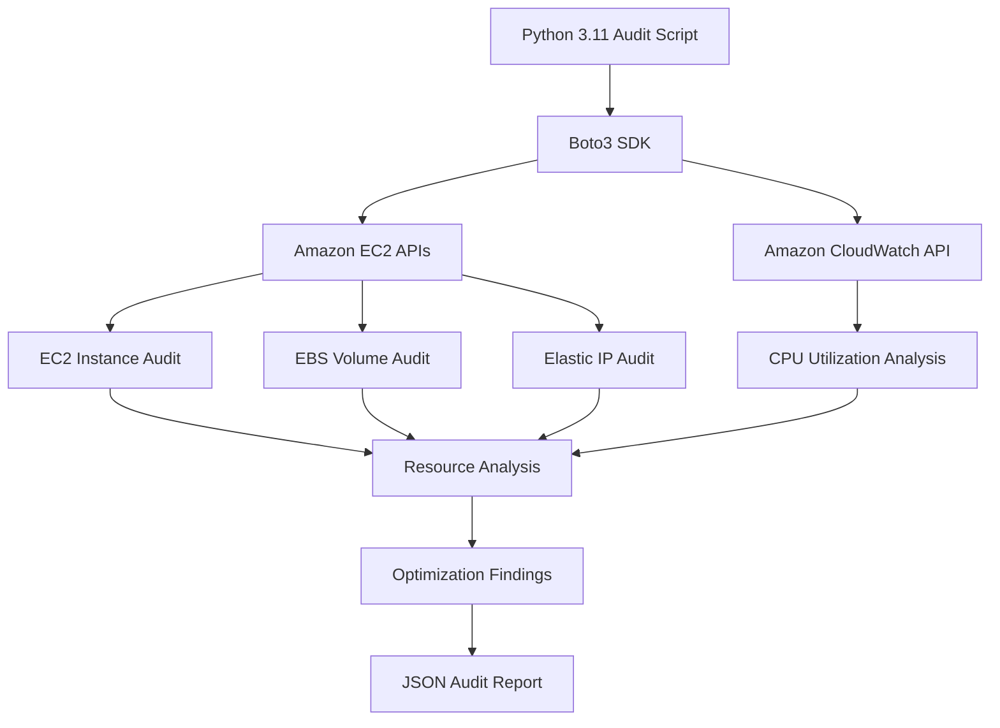

# AWS Cost Optimization & Resource Audit Tool

## Project Overview

The AWS Cost Optimization & Resource Audit Tool is a Python-based automation project that uses **Boto3** to inspect AWS resources, identify potential resource wastage, and generate an audit report in JSON format.

The project focuses on identifying resources that may create unnecessary AWS costs and providing recommendations for optimization.

## Problem Statement

Unused or underutilized AWS resources can increase cloud infrastructure expenses.

Manually checking EC2 instances, EBS volumes, Elastic IP addresses, and resource utilization can be time-consuming.

This project automates basic resource auditing and identifies potential optimization opportunities.

## Features

- **EC2 Audit:** Identifies EC2 instances and their current states.
- **EBS Audit:** Identifies unattached EBS volumes.
- **Elastic IP Audit:** Detects unassociated Elastic IP addresses.
- **CloudWatch Integration:** Retrieves EC2 CPU utilization metrics.
- **Resource Analysis:** Identifies potential optimization opportunities.
- **JSON Reporting:** Automatically generates an audit report.
- **Safe Recommendations:** Provides recommendations without automatically deleting or modifying resources.

## Technologies Used

- Python 3.11
- Boto3
- AWS EC2
- Amazon EBS
- AWS Elastic IP
- Amazon CloudWatch
- AWS IAM
- AWS CLI
- JSON

## Architecture



## Project Structure

```text
aws-cost-optimization/
│
├── resource_audit.py
├── requirements.txt
├── README.md
├── .gitignore
│
└── audit_report.json  # Generated locally; excluded from Git
```

## Prerequisites

1. Python 3.11 or later.
2. An AWS account.
3. AWS CLI configured or an EC2 IAM role.
4. Appropriate read-only IAM permissions.

### Required IAM Permissions

The IAM identity running the script requires these permissions:

**EC2:**
- `ec2:DescribeInstances`
- `ec2:DescribeVolumes`
- `ec2:DescribeAddresses`

**CloudWatch:**
- `cloudwatch:GetMetricStatistics`
- `cloudwatch:ListMetrics`
- `cloudwatch:GetMetricData`

These permissions allow the application to inspect resources and retrieve monitoring metrics.

## Installation and Execution

### 1. Clone the repository

```bash
git clone <YOUR_GITHUB_REPOSITORY_URL>
cd aws-cost-optimization
```

### 2. Create a virtual environment

```bash
python3.11 -m venv venv
```

### 3. Activate the environment

Linux:

```bash
source venv/bin/activate
```

### 4. Install dependencies

```bash
pip install -r requirements.txt
```

### 5. Configure AWS access

Use an IAM role attached to your EC2 instance or configure AWS CLI credentials securely.

Verify access:

```bash
aws sts get-caller-identity
```

### 6. Run the audit

```bash
python resource_audit.py
```

The application retrieves AWS resource information, analyzes CPU metrics, identifies potential optimization findings, and generates:

```text
audit_report.json
```

## CloudWatch CPU Analysis

The application retrieves the following EC2 CPU metrics:

- Average CPU utilization.
- Maximum CPU utilization.
- Number of available datapoints.

The application checks CPU history over a seven-day period.

A minimum of three datapoints is required before evaluating an instance against the configured CPU threshold.

If insufficient monitoring data is available, the application reports this instead of making an unreliable underutilization recommendation.

## Optimization Findings

The application currently identifies:

| Resource | Condition | Recommendation |
|---|---|---|
| EC2 | Stopped instance | Review whether the instance is still required. |
| EBS | Unattached volume | Verify its data and ownership before considering deletion. |
| Elastic IP | Unassociated address | Verify whether the IP is required before releasing it. |
| EC2 | Potentially low CPU utilization | Review CPU, memory, network, and application requirements before right-sizing. |

The application provides recommendations only. It does not automatically terminate instances, delete volumes, or release Elastic IP addresses.

## Security Considerations

- Uses IAM permissions instead of hardcoding AWS credentials.
- Uses read-only AWS API permissions for resource auditing.
- Excludes virtual environments and generated reports from Git.
- Does not automatically modify or delete AWS resources.

## Current Limitations

- CPU analysis depends on available CloudWatch datapoints.
- CPU utilization alone cannot determine whether an instance is underutilized.
- The project currently focuses on EC2, EBS, Elastic IP, and CPU metrics.
- Recommendations require manual verification before taking action.

## Future Enhancements

- AWS Cost Explorer integration.
- Automated notifications using Amazon SNS.
- Scheduled audits using AWS Lambda and EventBridge.
- Infrastructure provisioning using Terraform.
- CI/CD integration using GitHub Actions.

## Learning Outcomes

Through this project, I gained practical experience with:

- Automating AWS resource auditing using Python and Boto3.
- Interacting with AWS services through SDK APIs.
- Understanding EC2, EBS, and Elastic IP resources.
- Retrieving and analyzing CloudWatch metrics.
- Working with IAM permissions and roles.
- Generating structured JSON reports.
- Identifying potential AWS cost optimization opportunities.

## Author

Developed as a hands-on AWS and DevOps learning project.
